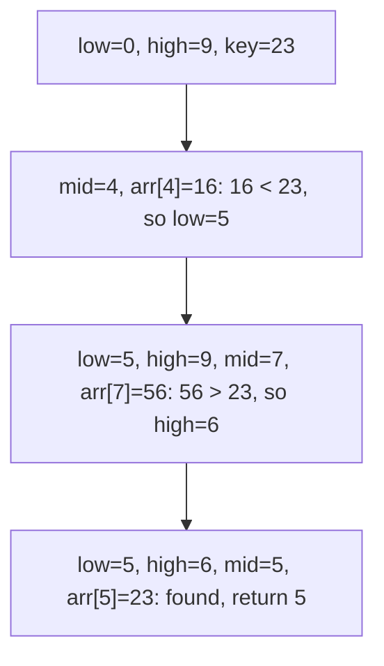
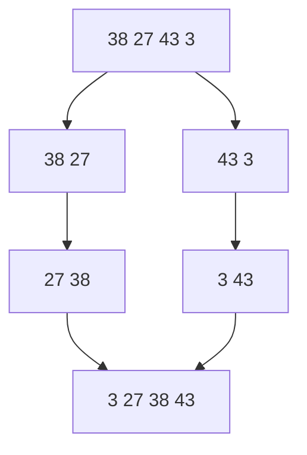
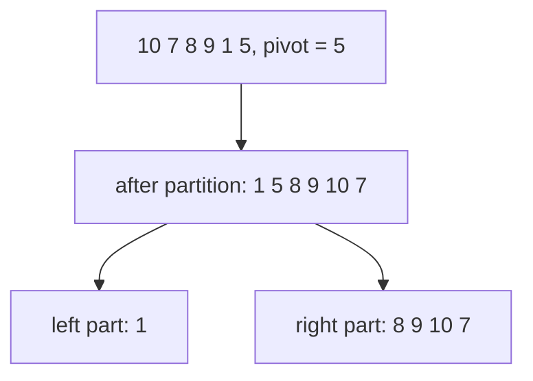
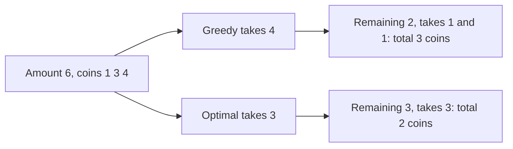
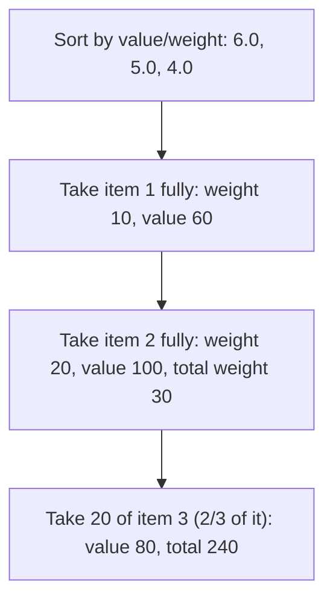
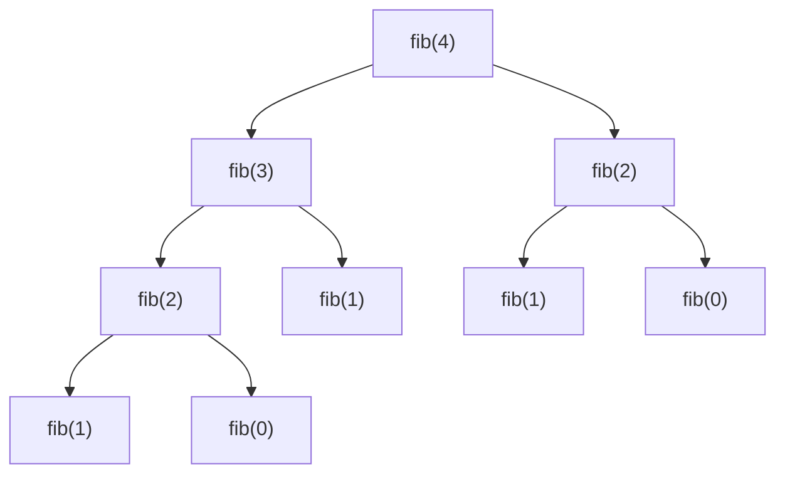
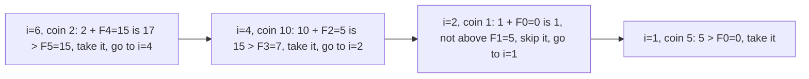
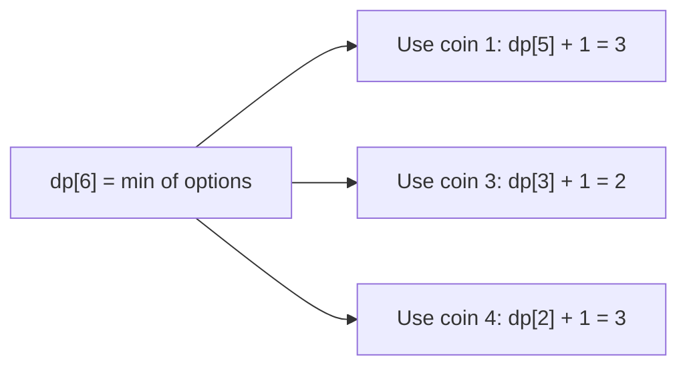
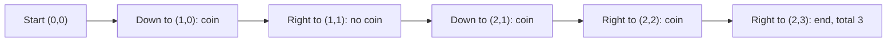
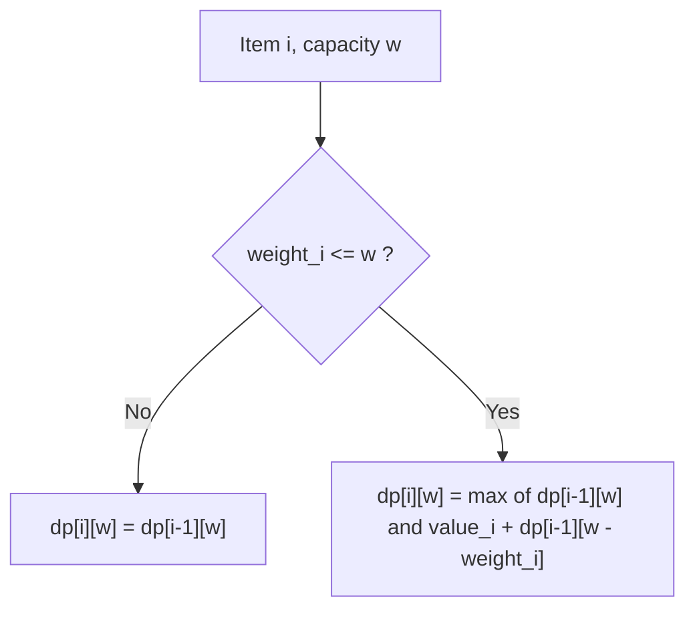

# Lab — 1st Batch

**Section:** [Lab](../README.md) · **Part:** [Part 0 — Final Year Question and Answer](../../README.md)

**Chandpur Science and Technology University (CSTU)**  
Department of Computer Science and Engineering  
**Examination:** B.Sc. Engineering 2nd Year 2nd Semester Final, 2024  
**Course Code:** CSE 2202 · **Course Title:** Algorithm Design and Analysis Sessional  
**Time:** 2 hours · **Full Marks:** 120  
**Instructions:** Answer any **one (1)** of the tick-mark questions. Each question carries 120 marks. Give the theory, algorithm or recurrence, sample input/output, result analysis, and a comparison table in the answer script.

> **Note on the source file.** The attached PDF (`1st Batch Lab Final Questions.pdf`) has two pages. **Page 1** is the CSE 2202 Algorithm Design and Analysis sessional paper, and it is fully answered below. **Page 2** is the CSE 2203 Class Test 04 (DBMS theory). That page is already covered in `Theory/Class-Test-04-2021-22`, so it is not repeated here.
>
> The file name says "Lab Final DBMS", but the CSE 2204 DBMS lab paper is not in the attached file or in the same folder. The answers below are for the algorithm paper that was actually provided.

**Language:** Python 3. The paper does not name a language, so Python is used for its short, readable code. Every code block below was run, and its output was checked against a brute-force or reference solution.

**Easiest question to start with:** **Question 1** (Linear and Binary Search). It uses only a loop and one comparison at a time, so start there.

---

## Question 1 — Time complexity and implementation of Linear and Binary Search `[120]`

> **Easiest question to start with.** It needs only a loop and a few comparisons.

### Question

Time Complexity Analysis and Implementation of Linear and Binary Search Algorithms.

### Answer

```python
def linear_search(arr, key):
    for i in range(len(arr)):
        if arr[i] == key:
            return i
    return -1


def binary_search(arr, key):  # arr must be sorted
    low, high = 0, len(arr) - 1
    while low <= high:
        mid = (low + high) // 2
        if arr[mid] == key:
            return mid
        elif arr[mid] < key:
            low = mid + 1
        else:
            high = mid - 1
    return -1
```

Sample input and output:

```python
arr = [2, 5, 8, 12, 16, 23, 38, 56, 72, 91]
print(linear_search(arr, 23))   # 5
print(binary_search(arr, 23))   # 5
print(linear_search(arr, 7))    # -1
print(binary_search(arr, 7))    # -1
```

Comparison table:

| Algorithm | Best case | Average case | Worst case | Space | Needs sorted input? |
|---|---|---|---|---|---|
| Linear search | O(1) | O(n) | O(n) | O(1) | No |
| Binary search | O(1) | O(log n) | O(log n) | O(1) iterative | Yes |

**Why binary search is O(log n):** each step halves the remaining range. The recurrence is T(n) = T(n/2) + O(1), which solves to O(log n). After k steps, about n / 2^k items remain, so the loop stops after about log₂ n steps.

**Trace for key 23 (binary search):**



Linear search checks indices 0 to 5, which is 6 comparisons. Binary search finds the same element in 3 comparisons.

<details>
<summary>Expand: understand the answer end to end</summary>

Think of the array as a row of numbered boxes, and the search as looking for one number inside.

**Linear search** is like checking boxes one by one from the left. You stop when you find the number or run out of boxes. In the worst case you look at every box, so the time grows with n.

**Binary search** works only when the boxes are already sorted. You look at the middle box:

- If the middle value equals the key, you are done.
- If the middle value is smaller than the key, the key must be in the right half, so throw away the left half.
- If the middle value is bigger than the key, the key must be in the left half, so throw away the right half.

Each look throws away half of the remaining boxes, so you need only about log₂ n looks. For 1,000,000 items that is about 20 comparisons.

| Step | low | high | mid | arr[mid] | Decision |
|---|---|---|---|---|---|
| 1 | 0 | 9 | 4 | 16 | 16 < 23, move low to 5 |
| 2 | 5 | 9 | 7 | 56 | 56 > 23, move high to 6 |
| 3 | 5 | 6 | 5 | 23 | Found at index 5 |

</details>

<details>
<summary>Expand: task-by-task answer plan</summary>

1. **Write linear search:** loop through the array, compare each element with the key, return the index on a match, otherwise return `-1`.
2. **Write binary search:** keep `low` and `high`, compute `mid`, compare, and shrink the range. Stop when `low > high`.
3. **Test both:** use a sample array, a key that exists, and a key that does not exist.
4. **Analyse linear search:** best case O(1) (first element), worst case O(n) (last element or missing), average O(n).
5. **Analyse binary search:** each step halves the range, so the recurrence is T(n) = T(n/2) + O(1), giving O(log n).
6. **Compare in a table:** list time complexity for best, average, and worst case, plus space and whether sorting is needed.

**Memory cue:** linear = check one by one, O(n) · binary = cut the range in half, O(log n) · binary needs sorted data.

</details>

---

## Question 2 — Merge Sort: iterative and recursive `[120]`

### Question

Implement Merge Sort using Iterative approach and Recursive approach and compare the time complexities.

### Answer

```python
def merge(a, left, mid, right):
    L = a[left:mid + 1]
    R = a[mid + 1:right + 1]
    i = j = 0
    k = left
    while i < len(L) and j < len(R):
        if L[i] <= R[j]:
            a[k] = L[i]
            i += 1
        else:
            a[k] = R[j]
            j += 1
        k += 1
    while i < len(L):
        a[k] = L[i]
        i += 1
        k += 1
    while j < len(R):
        a[k] = R[j]
        j += 1
        k += 1


def merge_sort_recursive(a, left=0, right=None):
    if right is None:
        right = len(a) - 1
    if left < right:
        mid = (left + right) // 2
        merge_sort_recursive(a, left, mid)
        merge_sort_recursive(a, mid + 1, right)
        merge(a, left, mid, right)
    return a


def merge_sort_iterative(a):
    n = len(a)
    width = 1
    while width < n:
        for left in range(0, n, 2 * width):
            mid = min(left + width - 1, n - 1)
            right = min(left + 2 * width - 1, n - 1)
            if mid < right:
                merge(a, left, mid, right)
        width *= 2
    return a
```

Sample input and output:

```python
data = [38, 27, 43, 3, 9, 82, 10]
print(merge_sort_recursive(list(data)))   # [3, 9, 10, 27, 38, 43, 82]
print(merge_sort_iterative(list(data)))   # [3, 9, 10, 27, 38, 43, 82]
```

Comparison table:

| Version | Best | Average | Worst | Extra space (merge buffer) | Recursion stack |
|---|---|---|---|---|---|
| Recursive | O(n log n) | O(n log n) | O(n log n) | O(n) | O(log n) |
| Iterative (bottom-up) | O(n log n) | O(n log n) | O(n log n) | O(n) | None |

**Why O(n log n):** the array is split in half each time, which gives log n levels. Each level merges n elements in total, which is O(n). The recurrence is T(n) = 2T(n/2) + O(n).

**Result:** both versions give the same sorted output and have the same time complexity. The iterative version avoids recursion, so it does not use a call stack.



---

## Question 3 — Quick Sort: iterative and recursive `[120]`

### Question

Implement Quick Sort using Iterative approach and Recursive approach and compare the time complexities.

### Answer

```python
def partition(a, low, high):
    pivot = a[high]
    i = low - 1
    for j in range(low, high):
        if a[j] <= pivot:
            i += 1
            a[i], a[j] = a[j], a[i]
    a[i + 1], a[high] = a[high], a[i + 1]
    return i + 1


def quick_sort_recursive(a, low=0, high=None):
    if high is None:
        high = len(a) - 1
    if low < high:
        p = partition(a, low, high)
        quick_sort_recursive(a, low, p - 1)
        quick_sort_recursive(a, p + 1, high)
    return a


def quick_sort_iterative(a):
    stack = [(0, len(a) - 1)]
    while stack:
        low, high = stack.pop()
        if low < high:
            p = partition(a, low, high)
            stack.append((low, p - 1))
            stack.append((p + 1, high))
    return a
```

Sample input and output:

```python
data = [10, 7, 8, 9, 1, 5]
print(quick_sort_recursive(list(data)))   # [1, 5, 7, 8, 9, 10]
print(quick_sort_iterative(list(data)))   # [1, 5, 7, 8, 9, 10]
```

Comparison table:

| Version | Best | Average | Worst | Space |
|---|---|---|---|---|
| Recursive | O(n log n) | O(n log n) | O(n²) | O(log n) average, O(n) worst (call stack) |
| Iterative (explicit stack) | O(n log n) | O(n log n) | O(n²) | O(log n) average, O(n) worst (explicit stack) |

**Why the worst case is O(n²):** the code uses the last element as the pivot. On an already-sorted or reverse-sorted array, the pivot always lands at one end, so one side is empty and the other has n − 1 elements. That gives T(n) = T(n − 1) + O(n).

**First partition trace** (pivot = 5, last element):



The recursive version calls itself on each side. The iterative version pushes the same two ranges onto a stack and pops them one at a time. Both perform the same partitions, so their time complexities are the same.

---

## Question 4 — Change-Making with a greedy approach, and its correctness `[120]`

### Question

Implement the Change-Making problem using a greedy approach and evaluate its correctness.

### Answer

```python
def greedy_change(amount, coins):
    result = []
    for c in sorted(coins, reverse=True):
        while amount >= c:
            result.append(c)
            amount -= c
    return result if amount == 0 else None
```

Sample input and output (Taka notes and coins):

```python
print(greedy_change(1234, [1000, 500, 100, 50, 20, 10, 5, 2, 1]))
# [1000, 100, 100, 20, 10, 2, 2]  -> 7 notes/coins
```

**Correctness check.** The greedy answer was compared with an exact DP solution (`change_dp`) for every amount from 0 to 3000 with Taka denominations. They gave the same number of coins for every amount. The DP solution is in the Question 8 answer.

**Counterexample.** With coins `[1, 3, 4]` and amount 6:

```python
print(greedy_change(6, [1, 3, 4]))   # [4, 1, 1]  -> 3 coins (greedy)
# optimal is [3, 3] -> 2 coins
```

Over amounts 1 to 199, greedy gave a non-optimal answer for 49 amounts. The first one is 6.



**Complexity:** O(k log k) to sort k denominations, plus the loop, which runs once per coin used.

**Conclusion:** the greedy method is correct when the denominations form a canonical system, such as the Taka notes above. It is not always correct for arbitrary coin sets, as the `[1, 3, 4]` example shows. The correctness result for Taka notes is verified by testing up to 3000, not by a general proof.

---

## Question 5 — Knapsack with a greedy approach, and its correctness `[120]`

### Question

Implement the Knapsack problem using a greedy approach and evaluate its correctness.

### Answer

This is the **fractional knapsack**, where an item can be split. Greedy works here: sort by value-to-weight ratio, and take items in that order.

```python
def fractional_knapsack(items, capacity):  # items: list of (value, weight)
    items = sorted(items, key=lambda x: x[0] / x[1], reverse=True)
    total = 0.0
    for v, w in items:
        if capacity <= 0:
            break
        take = min(w, capacity)
        total += v * take / w
        capacity -= take
    return total
```

Sample input and output:

```python
items = [(60, 10), (100, 20), (120, 30)]   # (value, weight)
print(fractional_knapsack(items, 50))      # 240.0
```



**Correctness evaluation.** Greedy is optimal for the fractional knapsack. Taking the best-ratio item first is always at least as good as any other choice, because the extra weight can be split. The result 240 matches the hand calculation: 60 + 100 + 120 × 20/30 = 240.

**Why greedy fails for the 0/1 knapsack** (each item taken whole):

```python
def knapsack_01_greedy(items, capacity):
    items = sorted(items, key=lambda x: x[0] / x[1], reverse=True)
    total = 0
    for v, w in items:
        if w <= capacity:
            total += v
            capacity -= w
    return total

print(knapsack_01_greedy([(60, 10), (100, 20), (120, 30)], 50))   # 160
# The optimal 0/1 answer is 220 (take items 2 and 3). See Question 10.
```

**Complexity:** O(n log n) for sorting, plus O(n) for the loop.

---

## Question 6 — Fibonacci with recursion and dynamic programming `[120]`

### Question

Implementation of Fibonacci Series using Recursion and Dynamic Programming.

### Answer

```python
def fib_recursive(n):
    if n <= 1:
        return n
    return fib_recursive(n - 1) + fib_recursive(n - 2)


def fib_dp(n):
    if n <= 1:
        return n
    prev, cur = 0, 1
    for _ in range(2, n + 1):
        prev, cur = cur, prev + cur
    return cur
```

Sample output:

```python
print([fib_dp(i) for i in range(10)])   # [0, 1, 1, 2, 3, 5, 8, 13, 21, 34]
print(fib_dp(10))                       # 55
```

**Number of recursive calls.** Counting every call to `fib_recursive(n)` gives 2·F(n+1) − 1 calls. For n = 5 this is 15 calls, and the check below confirms it.



`fib(2)` is computed twice, and the smaller values are repeated many times. This repetition is why the recursive version is slow.

| Version | Time | Space |
|---|---|---|
| Recursive | O(2ⁿ) roughly (about φⁿ, φ ≈ 1.618) | O(n) call stack |
| Dynamic programming (bottom-up) | O(n) | O(1) |

**Why DP is faster:** each value is computed once, from the two values before it, and the table is never recomputed.

---

## Question 7 — Coin-Row Problem with dynamic programming `[120]`

### Question

Implementation of Coin-Row Problem Dynamic Programming.

### Answer

Given a row of coins, pick coins to maximise the total value, with the rule that **no two adjacent coins can both be picked**.

Recurrence: F(i) = max( F(i − 1), c_i + F(i − 2) ), where c_i is the value of coin i.

```python
def coin_row(coins):
    n = len(coins)
    F = [0] * (n + 1)
    for i in range(1, n + 1):
        F[i] = max(F[i - 1], coins[i - 1] + (F[i - 2] if i >= 2 else 0))
    chosen = []
    i = n
    while i >= 1:
        if coins[i - 1] + (F[i - 2] if i >= 2 else 0) > F[i - 1]:
            chosen.append(i)
            i -= 2
        else:
            i -= 1
    return F[n], list(reversed(chosen))
```

Sample input and output:

```python
print(coin_row([5, 1, 2, 10, 6, 2]))   # (17, [1, 4, 6])
```

The chosen coins are at positions 1, 4, and 6, with values 5, 10, and 2, for a total of 17. The table F is `[0, 5, 5, 7, 15, 15, 17]`.

The result was checked against brute force over 2000 random rows, and the answers matched.



**Complexity:** O(n) time and O(n) space.

---

## Question 8 — Change-Making with dynamic programming `[120]`

### Question

Implementation of Change-Making problem Dynamic Programming.

### Answer

Find the minimum number of coins needed to make an amount, when any denomination can be used any number of times.

Recurrence: dp[i] = min over each coin c ≤ i of ( dp[i − c] + 1 ), with dp[0] = 0.

```python
def change_dp(amount, coins):
    INF = float("inf")
    dp = [0] + [INF] * amount
    for i in range(1, amount + 1):
        for c in coins:
            if c <= i and dp[i - c] + 1 < dp[i]:
                dp[i] = dp[i - c] + 1
    return dp[amount] if dp[amount] != INF else None
```

Sample input and output (coins `[1, 3, 4]`, amount 6):

```python
print([change_dp(i, [1, 3, 4]) for i in range(7)])   # [0, 1, 2, 1, 1, 2, 2]
print(change_dp(6, [1, 3, 4]))                        # 2  (3 + 3)
```

For amount 6, the three options are:



The minimum is 2, from coin 3. This is the answer where greedy gave 3 coins (see Question 4).

**Complexity:** O(n · m) time, where n is the amount and m is the number of coins. O(n) space.

---

## Question 9 — Coin-Collecting Problem with dynamic programming `[120]`

### Question

Implementation of coin Collecting Problem Dynamic Programming.

### Answer

A robot starts at the top-left cell of a grid, and can move only **right** or **down**. Each cell may hold a coin (1) or not (0). Find the maximum number of coins the robot can collect on the way to the bottom-right cell.

Recurrence: dp[i][j] = grid[i][j] + max( dp[i − 1][j], dp[i][j − 1] ).

```python
def coin_collect(grid):
    rows, cols = len(grid), len(grid[0])
    dp = [[0] * cols for _ in range(rows)]
    for i in range(rows):
        for j in range(cols):
            best = 0
            if i > 0:
                best = max(best, dp[i - 1][j])
            if j > 0:
                best = max(best, dp[i][j - 1])
            dp[i][j] = grid[i][j] + best
    return dp
```

Sample input and output:

```python
grid = [
    [0, 0, 1, 0],
    [1, 0, 0, 1],
    [0, 1, 1, 0],
]
dp = coin_collect(grid)
print(dp)           # [[0, 0, 1, 1], [1, 1, 1, 2], [1, 2, 3, 3]]
print(dp[-1][-1])   # 3
```

One optimal path collects 3 coins:



**Complexity:** O(rows · cols) time and space.

---

## Question 10 — 0/1 Knapsack with dynamic programming `[120]`

### Question

Implementation of 0/1 Knapsack Problem Dynamic Programming.

### Answer

Each item is either taken whole or left out. Find the maximum total value that fits in the capacity W.

Recurrence: dp[i][w] = max( dp[i − 1][w], value_i + dp[i − 1][w − weight_i] ) when weight_i ≤ w; otherwise dp[i][w] = dp[i − 1][w].

```python
def knapsack_01_dp(weights, values, W):
    n = len(weights)
    dp = [[0] * (W + 1) for _ in range(n + 1)]
    for i in range(1, n + 1):
        for w in range(W + 1):
            dp[i][w] = dp[i - 1][w]
            if weights[i - 1] <= w:
                dp[i][w] = max(dp[i][w], values[i - 1] + dp[i - 1][w - weights[i - 1]])
    return dp
```

Sample input and output:

```python
weights = [2, 3, 4, 5]
values = [3, 4, 5, 6]
table = knapsack_01_dp(weights, values, 5)
print(table[-1][-1])   # 7  (items 1 and 2: weight 2 + 3 = 5, value 3 + 4 = 7)
```

DP table (rows = first i items, columns = capacity w from 0 to 5):

| i (items used) | w=0 | w=1 | w=2 | w=3 | w=4 | w=5 |
|---|---|---|---|---|---|---|
| 0 | 0 | 0 | 0 | 0 | 0 | 0 |
| 1 (w=2, v=3) | 0 | 0 | 3 | 3 | 3 | 3 |
| 2 (w=3, v=4) | 0 | 0 | 3 | 4 | 4 | 7 |
| 3 (w=4, v=5) | 0 | 0 | 3 | 4 | 5 | 7 |
| 4 (w=5, v=6) | 0 | 0 | 3 | 4 | 5 | 7 |



The answer was checked against brute force over every subset of items for 500 random inputs, and all matched.

**Complexity:** O(n · W) time and space. This is pseudo-polynomial, because it depends on the capacity value W.

---

## Summary of answers

| Q | Problem | Method | Result on the example |
|---|---|---|---|
| 1 | Linear and Binary Search | Scan / halve the range | Key 23 at index 5 |
| 2 | Merge Sort | Recursive and iterative | Sorted array, O(n log n) |
| 3 | Quick Sort | Recursive and iterative | Sorted array, O(n log n) average |
| 4 | Change-Making | Greedy | 1234 → 7 coins; fails for `[1, 3, 4]` |
| 5 | Knapsack | Greedy (fractional) | 240 |
| 6 | Fibonacci | Recursion and DP | fib(10) = 55 |
| 7 | Coin-Row | DP | 17 |
| 8 | Change-Making | DP | 2 coins for amount 6 |
| 9 | Coin-Collecting | DP | 3 coins |
| 10 | 0/1 Knapsack | DP | 7 |
