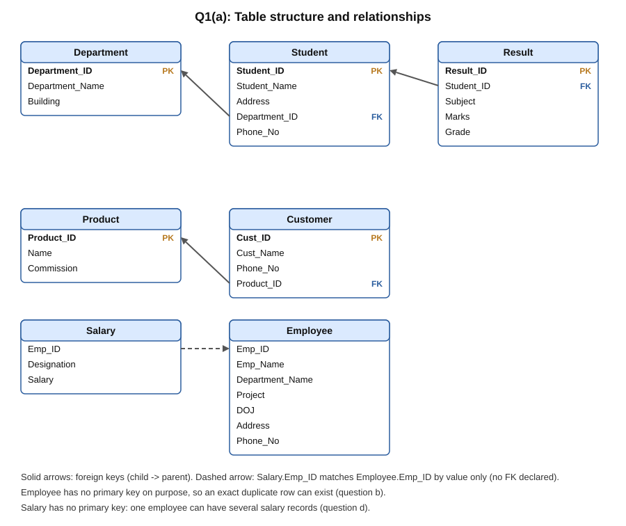
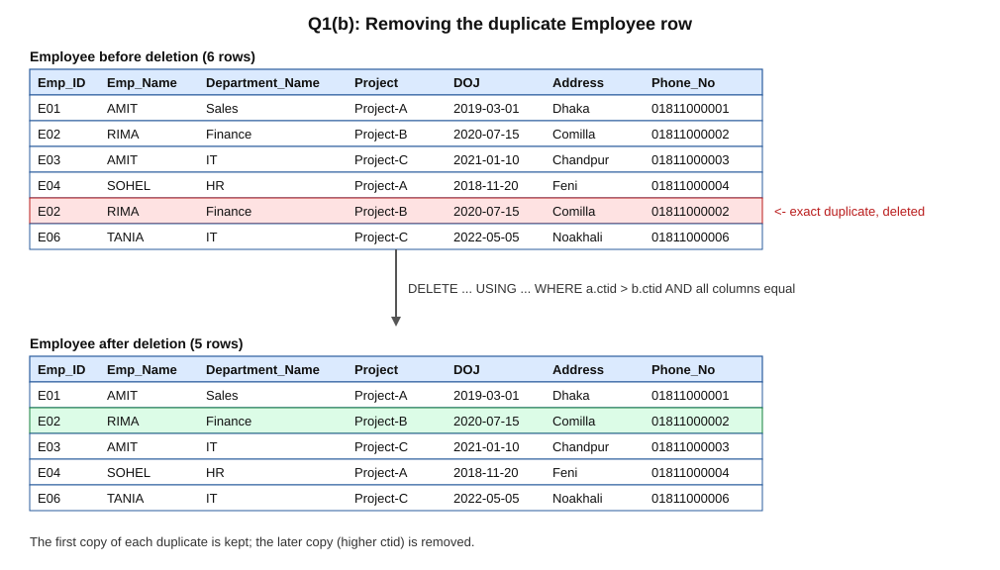
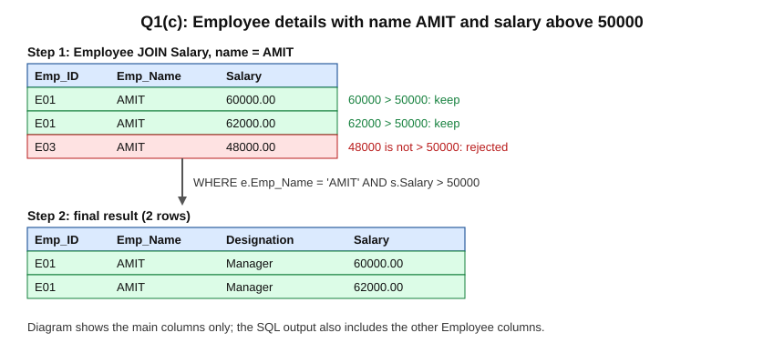
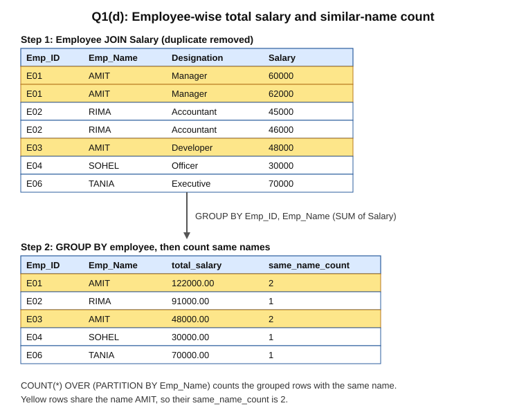
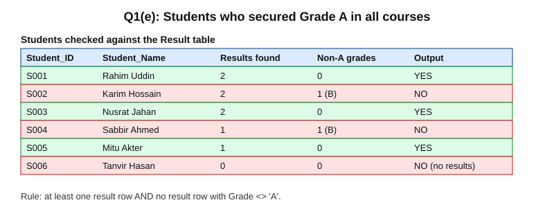
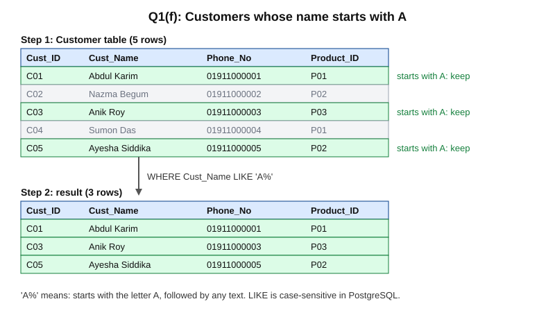
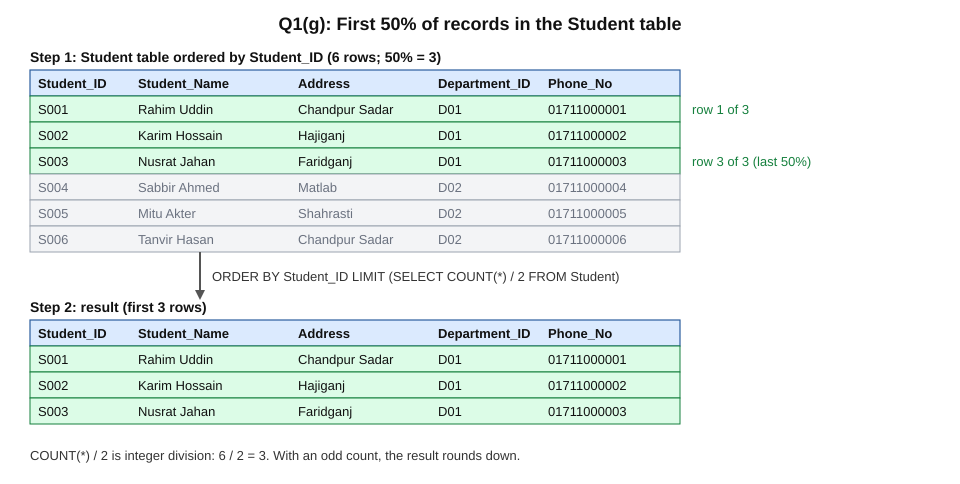
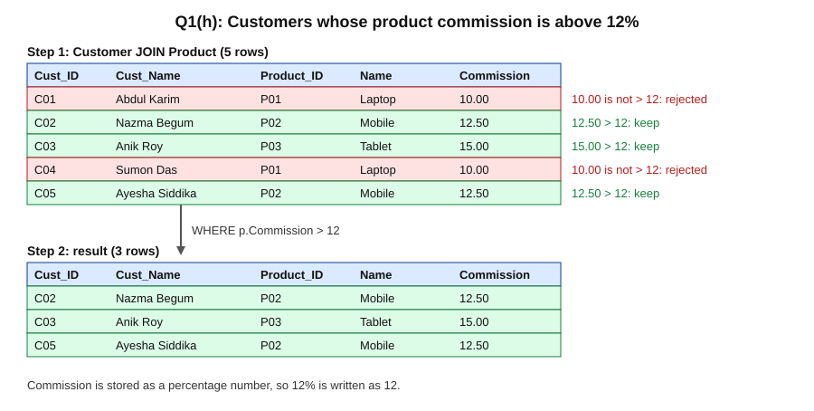

# Lab (CSE 2204) — 2nd Batch

**Section:** [Lab](../README.md) · **Part:** [Part 0 — Final Year Question and Answer](../../README.md)

**Chandpur Science and Technology University (CSTU)**  
Department of Computer Science and Engineering  
**Examination:** B.Sc. Engineering 2nd Year 2nd Semester Final, 2024  
**Course Code:** CSE 2204 · **Course Title:** Database Management System Sessional  
**Time:** 1 hour 20 minutes · **Full Marks:** 120  
**Instructions:** Answer any six questions from Question 1. Marks are shown beside each part.

> The attached PDF has three pages. **Page 1** is this CSE 2204 SQL paper and is fully answered below. **Pages 2 and 3** are an algorithms lab test and an EEE 2202 lab quiz, which are not part of this paper, so they are not included here.
>
> All eight parts (a)–(h) are answered for practice. The easiest part to start with is **Question 1(f)** (customers whose name starts with `A`). Its end-to-end explanation and task-by-task walkthrough can be expanded below.

**Database used:** PostgreSQL (the DBMS used in this lab). The schema and sample data come from Question 1(a), and every query below was run against that data.

**Assumptions:**
- `Customer.Phone No` is written as `Phone_No`, because SQL names cannot contain spaces.
- `Employee` and `Salary` have no primary key, as in the paper. This is why duplicate Employee rows can exist (1b), and why one employee can have several salary rows (1d).
- `Commission` is stored as a percentage number, so "12%" is written as `12`.

---

## Question 1(a) — Create tables and insert data `[20]`

### Question

Create all those tables respectively and insert relevant data into those tables.

### Answer

```sql
CREATE TABLE Department (
  Department_ID   VARCHAR(10) PRIMARY KEY,
  Department_Name VARCHAR(50),
  Building        VARCHAR(50)
);

CREATE TABLE Student (
  Student_ID    VARCHAR(10) PRIMARY KEY,
  Student_Name  VARCHAR(50),
  Address       VARCHAR(100),
  Department_ID VARCHAR(10) REFERENCES Department(Department_ID),
  Phone_No      VARCHAR(15)
);

CREATE TABLE Result (
  Result_ID  VARCHAR(10) PRIMARY KEY,
  Student_ID VARCHAR(10) REFERENCES Student(Student_ID),
  Subject    VARCHAR(50),
  Marks      INT,
  Grade      CHAR(1)
);

CREATE TABLE Employee (
  Emp_ID          VARCHAR(10),
  Emp_Name        VARCHAR(50),
  Department_Name VARCHAR(50),
  Project         VARCHAR(50),
  DOJ             DATE,
  Address         VARCHAR(100),
  Phone_No        VARCHAR(15)
);

CREATE TABLE Salary (
  Emp_ID      VARCHAR(10),
  Designation VARCHAR(50),
  Salary      NUMERIC(10,2)
);

CREATE TABLE Product (
  Product_ID VARCHAR(10) PRIMARY KEY,
  Name       VARCHAR(50),
  Commission NUMERIC(5,2)
);

CREATE TABLE Customer (
  Cust_ID    VARCHAR(10) PRIMARY KEY,
  Cust_Name  VARCHAR(50),
  Phone_No   VARCHAR(15),
  Product_ID VARCHAR(10) REFERENCES Product(Product_ID)
);
```

Sample data:

```sql
INSERT INTO Department VALUES
 ('D01','Computer Science and Engineering','Building A'),
 ('D02','Electrical and Electronic Engineering','Building B');

INSERT INTO Student VALUES
 ('S001','Rahim Uddin','Chandpur Sadar','D01','01711000001'),
 ('S002','Karim Hossain','Hajiganj','D01','01711000002'),
 ('S003','Nusrat Jahan','Faridganj','D01','01711000003'),
 ('S004','Sabbir Ahmed','Matlab','D02','01711000004'),
 ('S005','Mitu Akter','Shahrasti','D02','01711000005'),
 ('S006','Tanvir Hasan','Chandpur Sadar','D02','01711000006');

INSERT INTO Result VALUES
 ('R01','S001','Database',85,'A'),
 ('R02','S001','Programming',92,'A'),
 ('R03','S002','Database',72,'B'),
 ('R04','S002','Programming',88,'A'),
 ('R05','S003','Database',95,'A'),
 ('R06','S003','Programming',91,'A'),
 ('R07','S004','Database',60,'B'),
 ('R08','S005','Database',78,'A');

INSERT INTO Employee VALUES
 ('E01','AMIT','Sales','Project-A','2019-03-01','Dhaka','01811000001'),
 ('E02','RIMA','Finance','Project-B','2020-07-15','Comilla','01811000002'),
 ('E03','AMIT','IT','Project-C','2021-01-10','Chandpur','01811000003'),
 ('E04','SOHEL','HR','Project-A','2018-11-20','Feni','01811000004'),
 ('E02','RIMA','Finance','Project-B','2020-07-15','Comilla','01811000002'),  -- exact duplicate for 1(b)
 ('E06','TANIA','IT','Project-C','2022-05-05','Noakhali','01811000006');

INSERT INTO Salary VALUES
 ('E01','Manager',60000),
 ('E01','Manager',62000),
 ('E02','Accountant',45000),
 ('E02','Accountant',46000),
 ('E03','Developer',48000),
 ('E04','Officer',30000),
 ('E06','Executive',70000);

INSERT INTO Product VALUES
 ('P01','Laptop',10.00),
 ('P02','Mobile',12.50),
 ('P03','Tablet',15.00);

INSERT INTO Customer VALUES
 ('C01','Abdul Karim','01911000001','P01'),
 ('C02','Nazma Begum','01911000002','P02'),
 ('C03','Anik Roy','01911000003','P03'),
 ('C04','Sumon Das','01911000004','P01'),
 ('C05','Ayesha Siddika','01911000005','P02');
```

<p align="center">
  
</p>

<sub>Importable diagram: [Open the schema SVG](diagrams/q1-schema-erd.svg).</sub>

The `Employee` table has no primary key, so an exact duplicate row can be inserted; this is intentional for part (b). `Salary` also has no primary key, so one employee can have several salary records, which part (d) needs.

---

## Question 1(b) — Delete duplicate Employee records `[20]`

### Question

Delete the duplicate record from the Employee table (if any).

### Answer

```sql
DELETE FROM Employee a
USING Employee b
WHERE a.ctid > b.ctid
  AND a.Emp_ID = b.Emp_ID
  AND a.Emp_Name = b.Emp_Name
  AND a.Department_Name = b.Department_Name
  AND a.Project = b.Project
  AND a.DOJ = b.DOJ
  AND a.Address = b.Address
  AND a.Phone_No = b.Phone_No;
```

Result: **1 row deleted**, so the table goes from 6 rows to 5.

<p align="center">
  
</p>

<sub>Importable diagram: [Open the duplicate-removal SVG](diagrams/q2-employee-dedupe.svg).</sub>

`ctid` is PostgreSQL's internal physical row address. Two rows that match on every column are copies. The query keeps the copy with the smaller `ctid` and deletes the other one. Because `Employee` has no primary key, this is a practical way to remove the copy in place; if the table had a primary key, you would compare that key instead.

---

## Question 1(c) — AMIT employees with salary above 50000 `[20]`

### Question

Display the details of the employee whose name is AMIT and salary is greater than 50000.

### Answer

```sql
SELECT e.Emp_ID, e.Emp_Name, e.Department_Name, e.Project, e.DOJ,
       e.Address, e.Phone_No, s.Designation, s.Salary
FROM Employee e
JOIN Salary s ON e.Emp_ID = s.Emp_ID
WHERE e.Emp_Name = 'AMIT'
  AND s.Salary > 50000;
```

Output (2 rows):

| Emp_ID | Emp_Name | Department_Name | Project | DOJ | Address | Phone_No | Designation | Salary |
|---|---|---|---|---|---|---|---|---|
| E01 | AMIT | Sales | Project-A | 2019-03-01 | Dhaka | 01811000001 | Manager | 60000.00 |
| E01 | AMIT | Sales | Project-A | 2019-03-01 | Dhaka | 01811000001 | Manager | 62000.00 |

<p align="center">
  
</p>

<sub>Importable diagram: [Open the AMIT filter SVG](diagrams/q3-amit-salary-filter.svg).</sub>

The `JOIN` connects each employee to their salary records. The `WHERE` clause keeps only rows where the name is `AMIT` and the salary is above 50000. The other AMIT employee (E03, salary 48000) is excluded.

---

## Question 1(d) — Employee-wise total salary and similar-name count `[20]`

### Question

Retrieve employee-wise total salary and count similar names.

### Answer

```sql
SELECT e.Emp_ID,
       e.Emp_Name,
       SUM(s.Salary) AS total_salary,
       COUNT(*) OVER (PARTITION BY e.Emp_Name) AS same_name_count
FROM Employee e
JOIN Salary s ON e.Emp_ID = s.Emp_ID
GROUP BY e.Emp_ID, e.Emp_Name
ORDER BY e.Emp_ID;
```

Output (5 rows):

| Emp_ID | Emp_Name | total_salary | same_name_count |
|---|---|---|---|
| E01 | AMIT | 122000.00 | 2 |
| E02 | RIMA | 91000.00 | 1 |
| E03 | AMIT | 48000.00 | 2 |
| E04 | SOHEL | 30000.00 | 1 |
| E06 | TANIA | 70000.00 | 1 |

<p align="center">
  
</p>

<sub>Importable diagram: [Open the total-salary SVG](diagrams/q4-total-salary-same-name.svg).</sub>

`GROUP BY` produces one row per employee, and `SUM` adds all of that employee's salary records. `COUNT(*) OVER (PARTITION BY e.Emp_Name)` then counts how many employee rows share the same name, so both AMIT rows show `2`.

**Run part (b) first.** The duplicate RIMA row would join with both RIMA salary rows, so RIMA's total would be counted twice and show `182000.00` instead of `91000.00`.

---

## Question 1(e) — Students with Grade A in all courses `[20]`

### Question

Find the students who secured Grade A in all the courses.

### Answer

```sql
SELECT s.Student_ID, s.Student_Name
FROM Student s
WHERE EXISTS (
        SELECT 1 FROM Result r
        WHERE r.Student_ID = s.Student_ID)
  AND NOT EXISTS (
        SELECT 1 FROM Result r
        WHERE r.Student_ID = s.Student_ID
          AND r.Grade <> 'A')
ORDER BY s.Student_ID;
```

Output (3 rows):

| Student_ID | Student_Name |
|---|---|
| S001 | Rahim Uddin |
| S003 | Nusrat Jahan |
| S005 | Mitu Akter |

<p align="center">
  
</p>

<sub>Importable diagram: [Open the Grade A SVG](diagrams/q5-grade-a-all-courses.svg).</sub>

"Grade A in all courses" means the student has at least one result, and no result has a grade other than A. The first `EXISTS` removes students with no results (S006). Without it, `NOT EXISTS` alone would wrongly include S006.

---

## Question 1(f) — Customers whose name starts with 'A' `[20]`

> **Easiest question to start with.** It uses one table and one condition.

### Question

Find the customer whose name starts with the alphabet `'A'`.

### Answer

```sql
SELECT *
FROM Customer
WHERE Cust_Name LIKE 'A%'
ORDER BY Cust_ID;
```

Output (3 rows):

| Cust_ID | Cust_Name | Phone_No | Product_ID |
|---|---|---|---|
| C01 | Abdul Karim | 01911000001 | P01 |
| C03 | Anik Roy | 01911000003 | P03 |
| C05 | Ayesha Siddika | 01911000005 | P02 |

<p align="center">
  
</p>

<sub>Importable diagram: [Open the starts-with-A SVG](diagrams/q6-customer-starts-with-a.svg).</sub>

`LIKE 'A%'` means: first letter `A`, then any text (including none). `LIKE` is case-sensitive in PostgreSQL, so a name starting with a lowercase `a` would not match. Use `ILIKE 'a%'` to ignore case. On this data both versions return the same three rows.

<details>
<summary>Expand: understand the answer end to end</summary>

Think of `Customer` as a list of five names. The question asks for names whose first letter is `A`. The database checks every row against the pattern `'A%'`:

- `A` must match the first character exactly.
- `%` means "any number of any characters, including none". This is why `Abdul Karim` and `Ayesha Siddika` match.

Rows that match are kept, and the rest are skipped. `SELECT *` returns the full record, and `ORDER BY Cust_ID` sorts the result so the output is in a fixed order.

| Cust_ID | Cust_Name | Starts with A? | Kept? |
|---|---|---|---|
| C01 | Abdul Karim | Yes | Yes |
| C02 | Nazma Begum | No (starts with N) | No |
| C03 | Anik Roy | Yes | Yes |
| C04 | Sumon Das | No (starts with S) | No |
| C05 | Ayesha Siddika | Yes | Yes |

Why the `%` matters: `'A'` alone would only match a name that is exactly `A`. `'A%'` matches any name that begins with `A`.

</details>

<details>
<summary>Expand: task-by-task answer plan</summary>

1. **Pick the table:** the names are in `Customer.Cust_Name`.
2. **Write the filter:** `WHERE Cust_Name LIKE 'A%'`.
3. **Explain the pattern:** `A` matches the first letter; `%` matches any remaining text.
4. **Choose the columns:** `SELECT *` returns every customer column. You can list specific columns if the question asks for them.
5. **Mention case:** `LIKE` is case-sensitive in PostgreSQL. Use `ILIKE` if the names might be stored in mixed case.

**Memory cue:** `LIKE 'A%'` = starts with A · `LIKE '%A'` = ends with A · `LIKE '%A%'` = contains A.

</details>

---

## Question 1(g) — First 50% of Student records `[20]`

### Question

Find first 50% record from the student table.

### Answer

```sql
SELECT *
FROM Student
ORDER BY Student_ID
LIMIT (SELECT COUNT(*) / 2 FROM Student);
```

Output (3 rows, because the table has 6 students):

| Student_ID | Student_Name | Address | Department_ID | Phone_No |
|---|---|---|---|---|
| S001 | Rahim Uddin | Chandpur Sadar | D01 | 01711000001 |
| S002 | Karim Hossain | Hajiganj | D01 | 01711000002 |
| S003 | Nusrat Jahan | Faridganj | D01 | 01711000003 |

<p align="center">
  
</p>

<sub>Importable diagram: [Open the first-half SVG](diagrams/q7-first-half-student.svg).</sub>

`COUNT(*) / 2` gives half the number of rows. `LIMIT` returns that many rows after the `ORDER BY`, so "first" means the first in Student ID order. `COUNT(*) / 2` uses integer division, so with an odd count the result rounds down (for example, 7 students gives 3 rows).

---

## Question 1(h) — Customers with commission above 12% `[20]`

### Question

Find the customer details that get greater than 12% commission.

### Answer

```sql
SELECT c.Cust_ID, c.Cust_Name, c.Phone_No,
       p.Product_ID, p.Name, p.Commission
FROM Customer c
JOIN Product p ON c.Product_ID = p.Product_ID
WHERE p.Commission > 12
ORDER BY c.Cust_ID;
```

Output (3 rows):

| Cust_ID | Cust_Name | Phone_No | Product_ID | Name | Commission |
|---|---|---|---|---|---|
| C02 | Nazma Begum | 01911000002 | P02 | Mobile | 12.50 |
| C03 | Anik Roy | 01911000003 | P03 | Tablet | 15.00 |
| C05 | Ayesha Siddika | 01911000005 | P02 | Mobile | 12.50 |

<p align="center">
  
</p>

<sub>Importable diagram: [Open the commission SVG](diagrams/q8-commission-above-12.svg).</sub>

The `JOIN` connects each customer to their product, which holds the commission. Laptop (10%) is rejected, while Mobile (12.50%) and Tablet (15%) are kept. "Greater than 12%" is written as `> 12` because `Commission` is stored as a percentage number.
